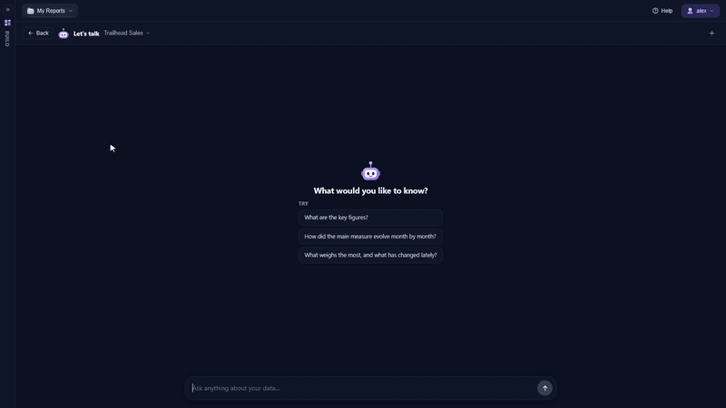
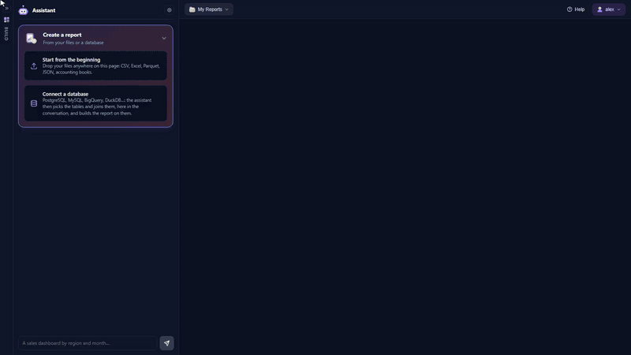
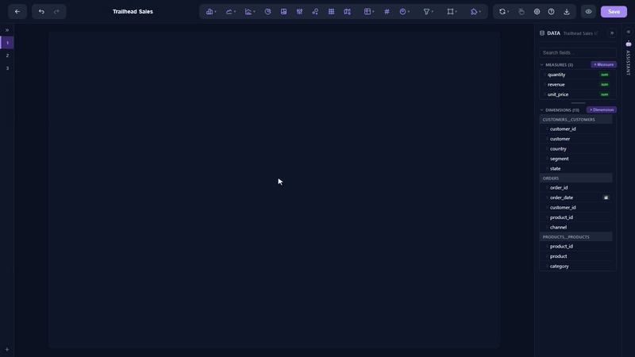
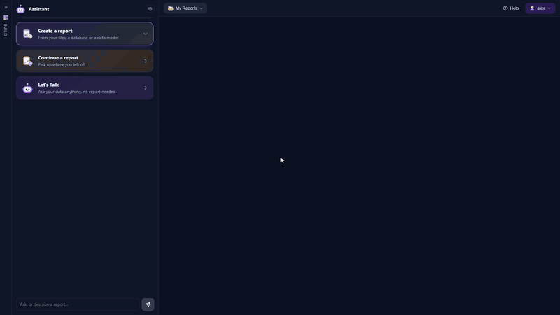
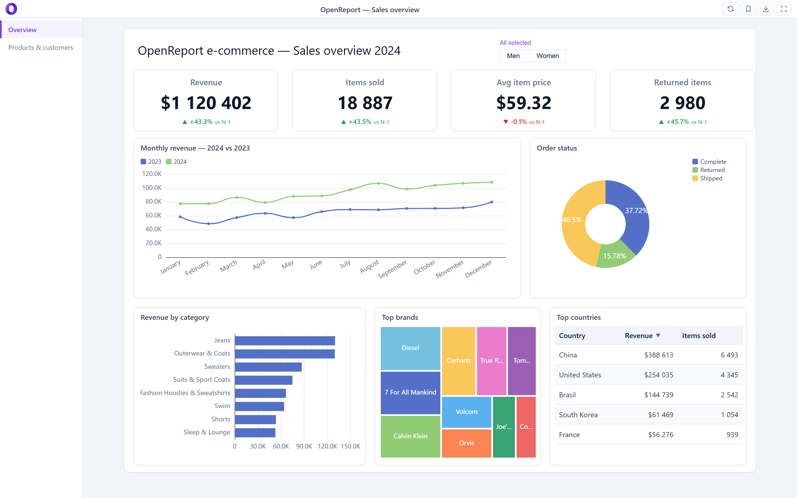
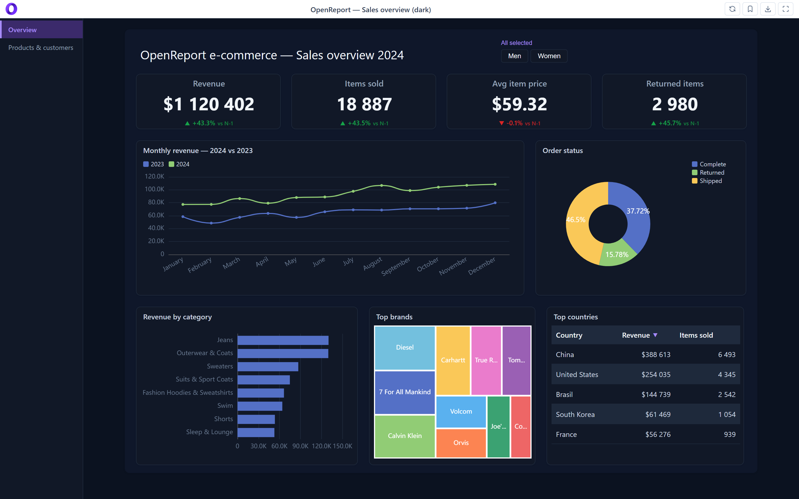
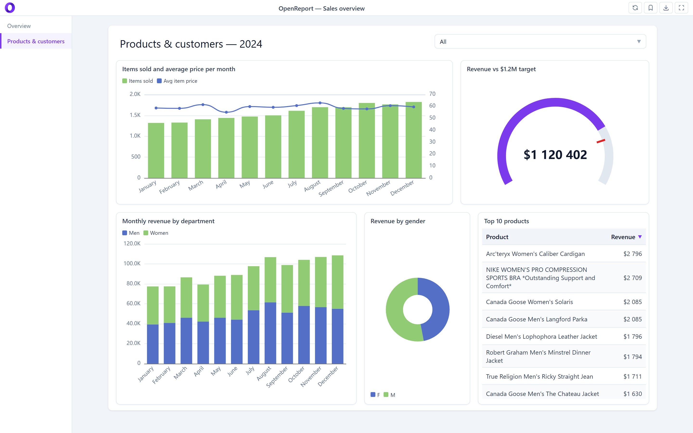
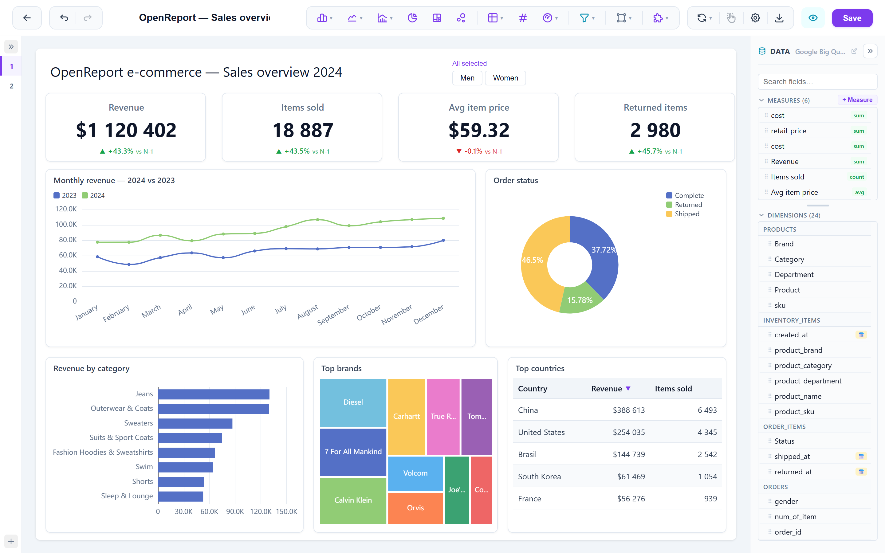
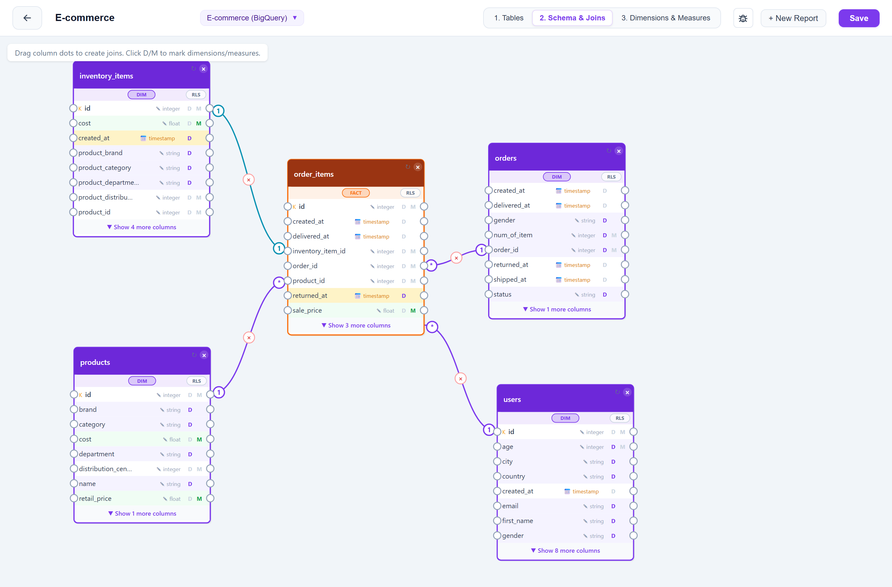

# Open Report

[](LICENSE)
[](https://github.com/cracky777/openreport/releases)
[](https://github.com/cracky777/openreport/pkgs/container/openreport)
[](https://github.com/cracky777/openreport/discussions)

> Free and open source under [AGPL-3.0](LICENSE). Self-host it, fork it, use it at work.

**The open source reporting tool, powered by AI.** Ask questions, generate reports or build them by hand, on data
that stays on your servers.

Superset too complicated? Metabase too limited? Power BI not open source? That's why I built Open Report: **think
Power BI / Looker Studio, but open source and self-hosted.** Point it at your database, describe your tables once
(joins, dimensions, measures), and it compiles the SQL for you, in your dialect, against your data. Nothing leaves
your infrastructure.

[Website](https://openreport.io) · [Try the editor](https://demo.openreport.io) · [Quick start](#quick-start) · [Features](#features) · [How it compares](#how-it-compares) · [Changelog](CHANGELOG.md)

🧪 **Still in development: we are looking for testers.** [Read more](#what-it-doesnt-do-yet).

### AI Ad-hoc analysis

Ask your data in plain words, in any language, and get the answer with its chart.



By default the assistant reads only Open Report's pre-aggregated cache, never your database. Bring a local model,
any OpenAI-compatible server, Anthropic or your own Claude subscription. It proposes, you apply.

### AI generating report

Describe the report you need and the AI builds it, page by page: visuals, measures, the data model and the look.



### Build it yourself

Build or fine-tune any report by hand, the way an analyst works. **[Try the editor online](https://demo.openreport.io)**,
no account needed: nothing you change there is saved.



### Govern your data

Ask where a number comes from: the lineage is read from [OpenMetadata](https://open-metadata.org).



## Screenshots

A sales report built on the public `thelook_ecommerce` BigQuery dataset. Every report has its own theme, and
reports can have several pages.



| Dark theme | Page two: combo chart, gauge, top-N table |
|---|---|
|  |  |

In the editor, drag fields from the model onto the page and tune each visual in the property panel, with
undo/redo, snap-to-grid and cross-filtering. In the model editor, pick tables, draw joins with their
cardinality, and flag dimensions and measures once for every report.

| Report editor | Model editor |
|---|---|
|  |  |

## Quick start

Just looking? [The editor runs online](https://demo.openreport.io), nothing to install. To run your own, one
container, plain HTTP on port 3001, built for amd64 and arm64:

```bash
mkdir openreport && cd openreport
curl -fsSL https://raw.githubusercontent.com/cracky777/openreport/master/docker-compose.yml -o docker-compose.yml
printf 'SESSION_SECRET=%s\nINTERNAL_TOKEN_SECRET=%s\nDATASOURCE_ENC_KEY=%s\n' \
  $(openssl rand -hex 32) $(openssl rand -hex 32) $(openssl rand -hex 32) > .env
docker compose up -d
```

Open http://localhost:3001 and sign up: **the first account becomes the admin**. A guided tour and the Help
page take it from there.

<details>
<summary>Data, secrets, upgrades and reverse proxies</summary>

Everything lives in the `openreport-data` volume (SQLite metadata, uploads, caches). The three secrets in
`.env` are mandatory, and `DATASOURCE_ENC_KEY` encrypts your database passwords, so back it up with the
volume. Upgrade with `docker compose pull && docker compose up -d`.

- **Behind your own reverse proxy** (Caddy, Traefik, Nginx Proxy Manager): point it at port 3001 and forward
  `X-Forwarded-Proto`. The session cookie gets its `Secure` flag from that header, so plain HTTP on the LAN
  and HTTPS through the proxy both work with the same image.
- **Public host with TLS built in**: the same [`docker-compose.yml`](docker-compose.yml) also bundles nginx
  and a Let's Encrypt certificate, behind the `https` profile. Clone the repository, add
  `COMPOSE_PROFILES=https` to `.env` and follow the comments at the top of the file.

</details>

<details>
<summary>From source, without Docker</summary>

Prerequisites: Node.js >= 22 (an older one is refused with an `EBADENGINE` error, because DuckDB cannot be
built on it) and npm >= 9.

```bash
git clone https://github.com/cracky777/openreport.git open-report
cd open-report
./install.sh
npm run dev
```

`install.sh` settles the Node version first: it installs Node 22 through nvm, under your own home directory
and without sudo, when the one on your PATH is missing or too old, then installs every dependency. Set
`OPENREPORT_SKIP_NODE=1` to manage Node yourself. On Windows, or to do it by hand: install Node 22, then
`npm run install:all`.

`npm run dev` serves the frontend on http://localhost:5173 and the API on http://localhost:3001. For a
production process without Docker, build the client with `npm run build` and run `npm start`: the server
then serves the built frontend itself on port 3001, with the same environment variables as the Docker image
(see [`.env.example`](.env.example)).

</details>

## Features

- **Your databases and files**: PostgreSQL, Amazon Redshift, Snowflake, Databricks, ClickHouse, MySQL, Oracle,
  SQL Server, Azure SQL, BigQuery, DuckDB. Files: CSV, Excel (.xlsx), Parquet, JSON, TSV, SQLite, DuckDB,
  several of them in one model, reshaped by the assistant into facts and dimensions when they need it.
  Accounting books (FEC, SAF-T, DATEV, SIE, XAF…) become a ready-made Finance package.
- **A semantic model**: joins with cardinality, dimensions, measures, calculated columns, filtered measures with
  CALCULATE semantics, same period last year, row-level security.
- **A free canvas and the charts you expect**: 15+ visual types (bar, line, combo, pie, scatter, pivot, table,
  waterfall, gauge, treemap, map, heatmap, slicers…), plus your own custom visuals. Free positioning,
  snap-to-grid, shapes, multi-page reports, themes, cross-filtering and cross-highlighting.
- **An assistant you control** (optional): bring a local model such as Ollama or LM Studio, any OpenAI-compatible
  API, Anthropic or your Claude subscription, and choose how much of the data it may read. Let's Talk, whole
  reports built and designed from a conversation, model building, file reshaping, maps created on demand and
  in-app help.
- **Sharing and governance**: workspaces with viewer, editor and admin roles, sharing between workspaces, public
  links, a metadata API for data catalogs, and lineage from OpenMetadata.
- **Performance**: pre-aggregation cache with scheduled refreshes, with a fallback to live queries.
- **Output**: export to PDF, PNG and Excel, plus a [REST API](API.md) for scripted refreshes with scoped tokens.

## How it compares

| | Open Report | Metabase | Apache Superset | Power BI |
|---|---|---|---|---|
| License | AGPL-3.0 | AGPL-3.0 + commercial | Apache-2.0 | Proprietary |
| Self-hosted | ✅ | ✅ | ✅ | Report Server only |
| Free-form, multi-page report canvas | ✅ | Grid dashboards | Grid dashboards | ✅ |
| Semantic model (joins, measures) | ✅ | Partial | Datasets and metrics | ✅ |
| Row-level security in the free edition | ✅ | Paid plans | ✅ | Licensed |
| Built-in data preparation (ETL, like Power Query) | Files only | ❌ | ❌ | ✅ |

Metabase and Superset are mature, widely used projects with many more connectors and years of production use.
If something in this table is wrong or out of date, please open an issue.

## What it doesn't do (yet)

Open Report is still in active development, and **we are looking for testers**. Install it, point it at your
own data and tell us what breaks or what is missing, in [Discussions](https://github.com/cracky777/openreport/discussions)
or [Issues](https://github.com/cracky777/openreport/issues/new/choose). Every report helps.

Known limits today:

- No ETL for databases. There is no data preparation step like Power BI's Power Query (Edit queries) for tables
  in a database: Open Report reads them as they are, so cleaning and merging happen upstream. Imported files are
  the exception: the assistant can reshape them (headers, unpivot, types, dimensions), and the recipe replays on
  every refresh.
- The pre-aggregation cache doesn't cover every measure. Non-additive ones and exotic SQL functions fall back to
  a live query against the source.
- Pivot tables are computed client-side, so very large result sets will hurt.
- No schema migration tool. Upgrades run idempotent ALTERs at boot.

## Telemetry

Once a day, a self-hosted instance sends an anonymous ping to openreport.io and gets back the latest version
number, so Admin › Settings can tell you when an update is out. It tells us how many installations exist and
which databases to support first. This is the whole payload, also shown in Admin before you decide:

```json
{ "instanceId": "random id made by your instance", "version": "0.6.0", "install": "docker",
  "databases": ["duckdb", "postgres"], "ai": true }
```

No names, emails, hostnames, tables, queries or data, and your IP address is not stored. Turn it off in
**Admin › Settings**, or for good with `OPENREPORT_TELEMETRY=0` in the environment (the switch then disappears).
The code is in [`server/utils/telemetry.js`](server/utils/telemetry.js).

## Contributing

Contributions are welcome.

- **[ARCHITECTURE.md](ARCHITECTURE.md)**: how a widget becomes SQL, and which file to open for which change.
  Read this first; it saves more time than it takes.
- **[CONTRIBUTING.md](CONTRIBUTING.md)**: setup, tests, and what a good pull request looks like.
- **[SECURITY.md](SECURITY.md)**: how to report a vulnerability. Please do not open an issue for one.
- **[CODE_OF_CONDUCT.md](CODE_OF_CONDUCT.md)**

Built with React, ECharts, Node.js, Express, SQLite and DuckDB.

Questions and ideas go to [Discussions](https://github.com/cracky777/openreport/discussions); confirmed bugs go
to [Issues](https://github.com/cracky777/openreport/issues/new/choose).

## License

[GNU Affero General Public License v3.0](LICENSE).

Free to use, self-host, modify and redistribute. If you run a modified version as a network service, the AGPL
requires you to publish your changes under the same license.

Contributions are accepted under the same license (see [CONTRIBUTING.md](CONTRIBUTING.md)).
