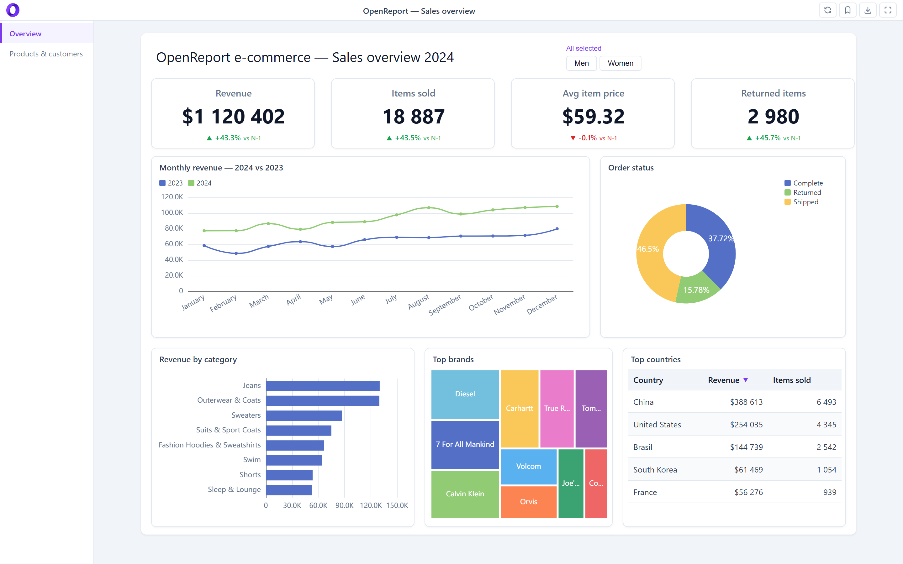
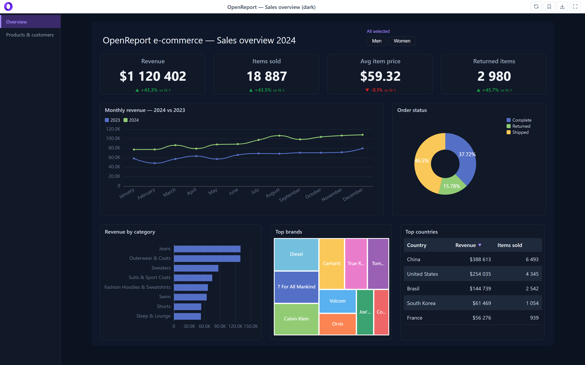
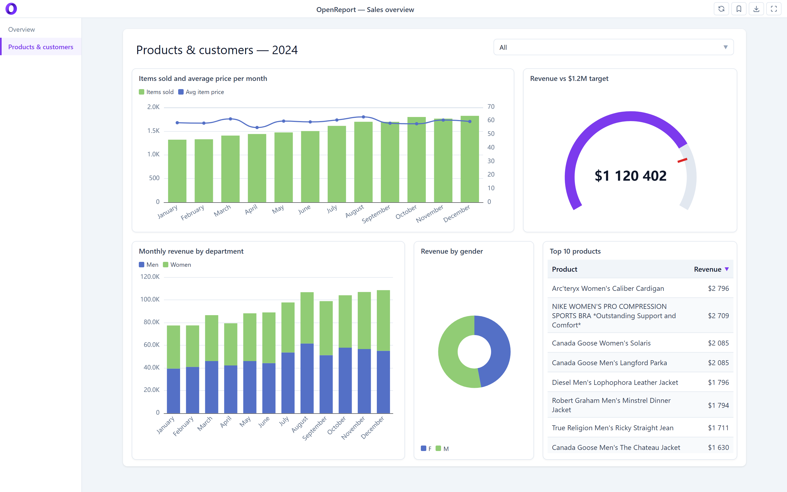
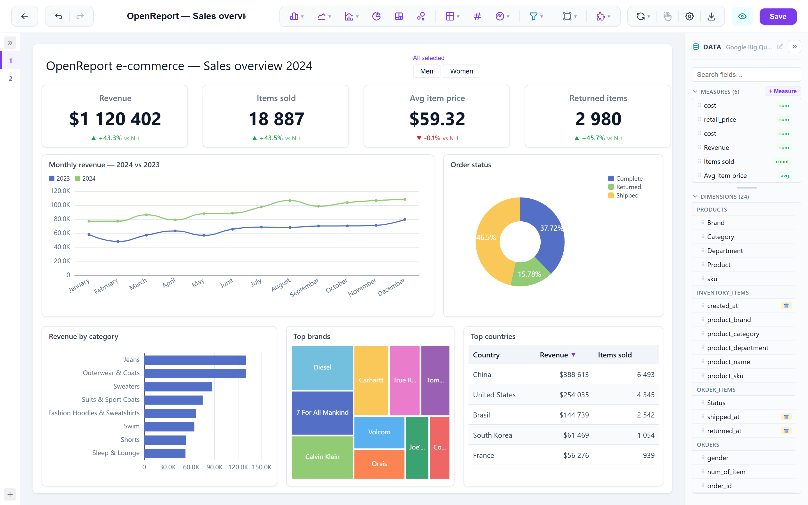
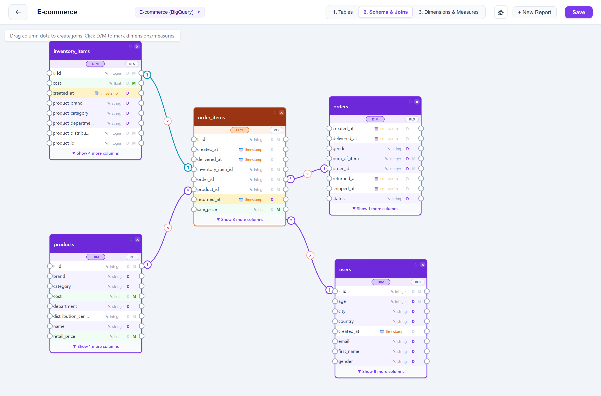

# Open Report

[](LICENSE)
[](https://github.com/cracky777/openreport/releases)
[](https://github.com/cracky777/openreport/pkgs/container/openreport)
[](https://github.com/cracky777/openreport/discussions)

> Free and open source under [AGPL-3.0](LICENSE). Self-host it, fork it, use it at work.

Superset too complicated? Metabase too limited? Power BI not open source? That's why I built Open Report.

An open source, self-hosted reporting and data visualization platform, easy to run and easy to configure. Point it at your database, describe your tables once (joins, dimensions, measures), then build interactive dashboards on a drag-and-drop canvas. It compiles the SQL for you, in your dialect, against your data. Nothing leaves your infrastructure.

**Think Power BI / Looker Studio, but open source and self-hosted.**

**With an AI assistant that never touches your live data.** Ask a question in any language and get a chart, or ask it to lay out a page, join the tables of a new model or explain a feature. It reads only Open Report's pre-aggregated cache, never your database, and works with Anthropic or any OpenAI-compatible server, a local one included. It proposes, you apply.

🧪 **Still in development: we are looking for testers.** [Read more](#what-it-doesnt-do-yet).

[Website](https://openreport.io) · [Quick start](#quick-start) · [Screenshots](#screenshots) · [How it compares](#how-it-compares) · [Changelog](CHANGELOG.md)



## Quick start

One container, plain HTTP on port 3001, built for amd64 and arm64:

```bash
mkdir openreport && cd openreport
curl -fsSL https://raw.githubusercontent.com/cracky777/openreport/master/docker-compose.yml -o docker-compose.yml
printf 'SESSION_SECRET=%s\nINTERNAL_TOKEN_SECRET=%s\nDATASOURCE_ENC_KEY=%s\n' \
  $(openssl rand -hex 32) $(openssl rand -hex 32) $(openssl rand -hex 32) > .env
docker compose up -d
```

Open http://localhost:3001 and sign up: **the first account becomes the admin**. A guided tour and the
assistant's Help tab take it from there.

<details>
<summary>Data, secrets, upgrades and reverse proxies</summary>

Everything lives in the `openreport-data` volume (SQLite metadata, uploads, caches). The three secrets in
`.env` are mandatory, and `DATASOURCE_ENC_KEY` encrypts your database passwords, so back it up with the
volume. Upgrade with `docker compose pull && docker compose up -d`.

- **Behind your own reverse proxy** (Caddy, Traefik, Nginx Proxy Manager): point it at port 3001 and forward
  `X-Forwarded-Proto`. The session cookie gets its `Secure` flag from that header, so plain HTTP on the LAN
  and HTTPS through the proxy both work with the same image.
- **Public host with TLS built in**: the same [`docker-compose.yml`](docker-compose.yml) also bundles nginx
  and a Let's Encrypt certificate, behind the `https` profile. Clone the repository, add
  `COMPOSE_PROFILES=https` to `.env` and follow the comments at the top of the file.

</details>

<details>
<summary>From source, without Docker</summary>

Prerequisites: Node.js >= 22 (an older one is refused with an `EBADENGINE` error, because DuckDB cannot be
built on it) and npm >= 9.

```bash
git clone https://github.com/cracky777/openreport.git open-report
cd open-report
./install.sh
npm run dev
```

`install.sh` settles the Node version first: it installs Node 22 through nvm, under your own home directory
and without sudo, when the one on your PATH is missing or too old, then installs every dependency. Set
`OPENREPORT_SKIP_NODE=1` to manage Node yourself. On Windows, or to do it by hand: install Node 22, then
`npm run install:all`.

`npm run dev` serves the frontend on http://localhost:5173 and the API on http://localhost:3001. For a
production process without Docker, build the client with `npm run build` and run `npm start`: the server
then serves the built frontend itself on port 3001, with the same environment variables as the Docker image
(see [`.env.example`](.env.example)).

</details>

## Screenshots

A sales report built on the public `thelook_ecommerce` BigQuery dataset. Every report has its own theme, and
reports can have several pages.

| Dark theme | Page two: combo chart, gauge, top-N table |
|---|---|
|  |  |

| Report editor | Model editor |
|---|---|
|  |  |

In the editor, drag fields from the model onto the page and tune each visual in the property panel, with
undo/redo, snap-to-grid and cross-filtering. In the model editor, pick tables, draw joins with their
cardinality, and flag dimensions and measures once for every report.

## How it compares

| | Open Report | Metabase | Apache Superset | Power BI |
|---|---|---|---|---|
| License | AGPL-3.0 | AGPL-3.0 + commercial | Apache-2.0 | Proprietary |
| Self-hosted | ✅ | ✅ | ✅ | Report Server only |
| Free-form, multi-page report canvas | ✅ | Grid dashboards | Grid dashboards | ✅ |
| Semantic model (joins, measures) | ✅ | Partial | Datasets and metrics | ✅ |
| Row-level security in the free edition | ✅ | Paid plans | ✅ | Licensed |
| Built-in data preparation (ETL, like Power Query) | ❌ | ❌ | ❌ | ✅ |

Metabase and Superset are mature, widely used projects with many more connectors and years of production use.
If something in this table is wrong or out of date, please open an issue.

## Features

- **Data**: PostgreSQL, Amazon Redshift, Snowflake, Databricks, ClickHouse, MySQL, Oracle, SQL Server, Azure SQL,
  BigQuery, DuckDB. Files: CSV, Excel (.xlsx), Parquet, JSON, TSV, SQLite, DuckDB, several of them in one model.
- **Modeling**: joins with cardinality, dimensions, measures, calculated columns, filtered measures with
  CALCULATE semantics, same period last year, row-level security.
- **Reports**: 10+ visual types (bar, line, pie, pivot, table, waterfall, gauge, treemap, slicers…), plus your
  own custom visuals. Free positioning, snap-to-grid, shapes, multi-page reports, themes, cross-filtering and
  cross-highlighting.
- **AI assistant** (optional, bring your own provider): charts from questions, page layout, model building and
  in-app help.
- **Performance**: pre-aggregation cache with scheduled refreshes, with a fallback to live queries.
- **Collaboration**: workspaces with viewer, editor and admin roles, sharing between workspaces, public links.
- **Output**: export to PDF, PNG and Excel, plus a [REST API](API.md) for scripted refreshes with scoped tokens.

## What it doesn't do (yet)

Open Report is still in active development, and **we are looking for testers**. Install it, point it at your
own data and tell us what breaks or what is missing, in [Discussions](https://github.com/cracky777/openreport/discussions)
or [Issues](https://github.com/cracky777/openreport/issues/new/choose). Every report helps.

Known limits today:

- No ETL. There is no data preparation step like Power BI's Power Query (Edit queries): Open Report reads your
  tables as they are, so cleaning, reshaping and merging happen upstream, in your database or your files.
- The pre-aggregation cache doesn't cover every measure. Non-additive ones and exotic SQL functions fall back to
  a live query against the source.
- Pivot tables are computed client-side, so very large result sets will hurt.
- No schema migration tool. Upgrades run idempotent ALTERs at boot.

## Contributing

Contributions are welcome.

- **[ARCHITECTURE.md](ARCHITECTURE.md)**: how a widget becomes SQL, and which file to open for which change.
  Read this first; it saves more time than it takes.
- **[CONTRIBUTING.md](CONTRIBUTING.md)**: setup, tests, and what a good pull request looks like.
- **[SECURITY.md](SECURITY.md)**: how to report a vulnerability. Please do not open an issue for one.
- **[CODE_OF_CONDUCT.md](CODE_OF_CONDUCT.md)**

Built with React, ECharts, Node.js, Express, SQLite and DuckDB.

Questions and ideas go to [Discussions](https://github.com/cracky777/openreport/discussions); confirmed bugs go
to [Issues](https://github.com/cracky777/openreport/issues/new/choose).

## License

[GNU Affero General Public License v3.0](LICENSE).

Free to use, self-host, modify and redistribute. If you run a modified version as a network service, the AGPL
requires you to publish your changes under the same license.

Contributions are accepted under the same license (see [CONTRIBUTING.md](CONTRIBUTING.md)).
